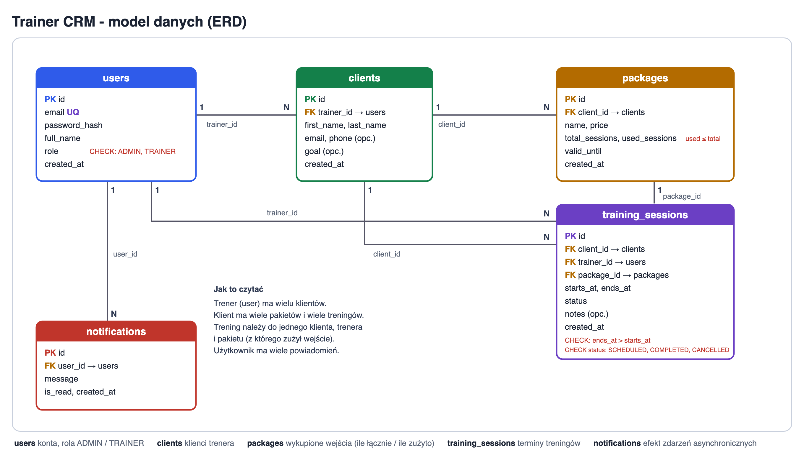

# Trainer CRM

CRM dla trenerów personalnych - projekt indywidualny z przedmiotu ZTPAI (Zaawansowane Technologie Programowania Aplikacji Internetowych).

## Problem biznesowy

Trener personalny prowadzi klientów w arkuszu i notatkach: kto ma wykupiony pakiet, ile wejść mu zostało,
kiedy jest umówiony. Efekt to podwójne rezerwacje, treningi bez opłaconego pakietu i zapomniane odwołania.

Aplikacja pozwala trenerowi:

- prowadzić bazę swoich klientów,
- sprzedawać klientom pakiety treningów (ilość wejść, cena, termin ważności),
- planować treningi tak, żeby system pilnował pakietu i kolizji terminów,
- dostawać powiadomienia o zaplanowanych treningach i wyczerpaniu pakietu.

Administrator zarządza kontami trenerów i ma wgląd w dane wszystkich trenerów.

## Stack

| Warstwa | Technologia |
|---|---|
| Backend | Node.js 22+, Express 5 (REST API, CommonJS) |
| Baza danych | PostgreSQL 16, Knex (zapytania, migracje, seed) |
| Walidacja i DTO | Zod (dane wejściowe) + mappery (dane wyjściowe) |
| Uwierzytelnianie | JWT (Bearer), hasła hashowane bcrypt |
| Dokumentacja API | Swagger UI (OpenAPI 3.0) |
| Zdarzenia | wbudowany `EventEmitter` |
| Testy | `node:test` + `supertest` |
| Frontend | React + Vite, `react-router-dom` |
| Uruchamianie | Docker Compose (baza, backend, frontend w nginx) |
| CI | GitHub Actions |

## Uruchomienie (Docker)

Potrzebne: Docker z Docker Compose.

```bash
git clone https://github.com/frycu07/trainer-crm.git
cd trainer-crm
cp .env.example .env
```

W pliku `.env` zmień wartości `change-me`: `DB_PASSWORD`, `ADMIN_PASSWORD` oraz `JWT_SECRET`
(minimum 32 znaki, np. `openssl rand -hex 32`). Pamiętaj, żeby hasło w `DATABASE_URL` i `TEST_DATABASE_URL`
było takie samo jak `DB_PASSWORD` (te dwie zmienne są potrzebne tylko przy uruchomieniu lokalnym).

```bash
docker compose up --build
```

Przy starcie backend sam uruchamia migracje i tworzy konto administratora.

| Co | Adres |
|---|---|
| Aplikacja (frontend) | http://localhost:8080 |
| API i dokumentacja Swagger | http://localhost:3000/api/docs |

Logowanie: e-mail i hasło z `ADMIN_EMAIL` i `ADMIN_PASSWORD` w pliku `.env`.
Konta trenerów dodaje administrator w zakładce „Użytkownicy".

Zatrzymanie: `docker compose down` (dane zostają w wolumenie), a `docker compose down -v` usuwa także bazę.

## Uruchomienie deweloperskie

Baza w Dockerze, backend i frontend lokalnie (potrzebny Node.js 22+):

```bash
docker compose up -d db          # PostgreSQL na porcie 5433

cd backend
npm install
npm run migrate                  # tworzy tabele
npm run seed                     # tworzy konto administratora
npm run dev                      # API na http://localhost:3000

cd ../frontend                   # w drugim terminalu
npm install
npm run dev                      # aplikacja na http://localhost:5173
```

Vite przekazuje zapytania `/api` do backendu (`vite.config.js`), dlatego nie jest potrzebny CORS.
Jeśli backend działa na innym porcie, ustaw `API_URL`, np. `API_URL=http://localhost:3010 npm run dev`.

## Testy

```bash
cd backend
npm test                # testy jednostkowe + integracyjne
npm run test:unit       # tylko jednostkowe (bez bazy)
npm run test:integration
```

- Testy jednostkowe sprawdzają logikę biznesową w service'ach na atrapach repozytoriów.
- Testy integracyjne uruchamiają prawdziwą aplikację i bazę `trainer_crm_test`
  (tworzy ją `docker/postgres/init.sql`), więc nie ruszają danych deweloperskich.
- To samo uruchamia CI przy każdym pushu.

## Role

- `ADMIN` - zarządza użytkownikami, widzi i edytuje dane wszystkich trenerów, jako jedyny usuwa treningi.
- `TRAINER` - pracuje tylko na swoich klientach, pakietach i treningach. Cudzy zasób zwraca 404,
  żeby nie zdradzać, że istnieje.

## Model danych

Diagram ERD (relacje 1 do N, klucze główne PK i obce FK):



| Tabela | Znaczenie |
|---|---|
| `users` | konta (e-mail, hash hasła, imię i nazwisko, rola `ADMIN` / `TRAINER`) |
| `clients` | klienci trenera (`trainer_id`) |
| `packages` | pakiety klienta: `total_sessions`, `used_sessions`, cena, `valid_until` |
| `training_sessions` | treningi: klient, trener, pakiet, `starts_at`, `ends_at`, status, notatka |
| `notifications` | powiadomienia użytkownika (`is_read`) |

Integralność pilnuje też baza: `UNIQUE` na e-mailu, klucze obce oraz `CHECK` na rolach, statusach i licznikach pakietu.

## Reguły biznesowe

Wszystkie są w warstwie service (`backend/src/modules/*/*.service.js`).

| # | Reguła | Błąd |
|---|---|---|
| R1 | Trening wymaga aktywnego pakietu (wolne wejścia i ważność w dniu treningu, wybierany jest pakiet z najwcześniejszą ważnością). Zaplanowanie zajmuje jedno wejście w transakcji. | 409 `NO_ACTIVE_PACKAGE` |
| R2 | Trener nie może mieć dwóch nakładających się treningów (przedziały `[start, end)`). | 409 `TRAINER_NOT_AVAILABLE` |
| R3 | Treningu nie można zaplanować w przeszłości, czas trwania to 30-180 minut. | 400 `VALIDATION_ERROR` |
| R4 | Dozwolone przejścia statusu: `SCHEDULED` na `COMPLETED` albo `CANCELLED`. | 409 `INVALID_STATUS_TRANSITION` |
| R5 | Odwołanie najpóźniej 24 h przed startem, wejście wraca do pakietu w transakcji. | 409 `CANCELLATION_TOO_LATE` |
| R6 | Nie można usunąć klienta z zaplanowanymi treningami. | 409 `CLIENT_HAS_SCHEDULED_SESSIONS` |

## Mechanizm asynchroniczny

Po zaplanowaniu treningu service emituje zdarzenie `session.scheduled` (a przy zajęciu ostatniego wejścia
także `package.exhausted`) na wspólnym `EventEmitter` (`backend/src/events/eventBus.js`) i od razu zwraca odpowiedź.
Listener (`notificationListeners.js`) zapisuje powiadomienie w bazie niezależnie od żądania HTTP,
a jego błąd nie psuje odpowiedzi dla użytkownika.

## API

Wszystkie ścieżki mają prefiks `/api`. Poza `health`, `docs` i logowaniem wymagają nagłówka
`Authorization: Bearer <token>`. Pełna specyfikacja jest w Swaggerze: http://localhost:3000/api/docs.

| Endpoint | Kto | Opis |
|---|---|---|
| `GET /health` | publiczny | stan aplikacji |
| `POST /auth/login` | publiczny | logowanie, zwraca token i użytkownika |
| `GET /auth/me` | zalogowany | dane zalogowanego użytkownika |
| `GET, POST /users`, `DELETE /users/:id` | ADMIN | zarządzanie użytkownikami |
| `GET, POST /clients`, `GET, PUT, DELETE /clients/:id` | zalogowany | klienci (lista: `page`, `limit`, `q`) |
| `GET /packages?clientId=`, `POST /packages`, `PUT, DELETE /packages/:id` | zalogowany | pakiety klienta |
| `GET, POST /sessions`, `GET, PATCH /sessions/:id` | zalogowany | treningi (lista: `page`, `limit`, `status`, `clientId`, `from`, `to`) |
| `PATCH /sessions/:id/complete`, `PATCH /sessions/:id/cancel` | zalogowany | zmiana statusu |
| `DELETE /sessions/:id` | ADMIN | usunięcie treningu, który nie jest zaplanowany |
| `GET /notifications`, `PATCH /notifications/:id/read` | zalogowany | powiadomienia użytkownika |

Błędy mają jeden format: `{ "error": { "code", "message", "details": [] } }`.
Kody HTTP: 200, 201, 204 przy sukcesie, 400 walidacja, 401 brak lub zły token, 403 brak uprawnień,
404 brak zasobu, 409 złamana reguła biznesowa.

## Element rozszerzony: CI

`.github/workflows/ci.yml` uruchamia się przy pushu i pull requeście na `main`:

- job `backend`: PostgreSQL jako kontener usługowy, `npm ci`, `npm test`,
- job `frontend`: `npm ci` i `npm run build`.

## Struktura katalogów

```
trainer-crm/
├── docker-compose.yml           # baza, backend, frontend
├── docker/postgres/init.sql     # tworzy bazę testową
├── docs/erd.png                 # diagram ERD
├── .env.example                 # wzór konfiguracji
├── .github/workflows/ci.yml
├── backend/
│   ├── Dockerfile
│   ├── src/
│   │   ├── app.js, server.js
│   │   ├── config/              # jedyne miejsce czytające zmienne środowiskowe (Zod)
│   │   ├── db/                  # połączenie, migracje, seed
│   │   ├── middleware/          # authenticate, authorize, validate, errorHandler
│   │   ├── events/              # EventEmitter i listenery powiadomień
│   │   ├── docs/openapi.js      # specyfikacja dla Swaggera
│   │   └── modules/             # auth, users, clients, packages, sessions, notifications
│   └── tests/                   # unit/ i integration/
└── frontend/
    ├── Dockerfile, nginx.conf
    └── src/                     # App, api.js, AuthContext, components/, pages/
```

Każdy moduł backendu ma te same warstwy: `routes` (ścieżki, walidacja, role), `controller` (HTTP),
`service` (logika biznesowa), `repository` (zapytania Knex), `schemas` (Zod) i `mapper` (DTO wyjściowe).
